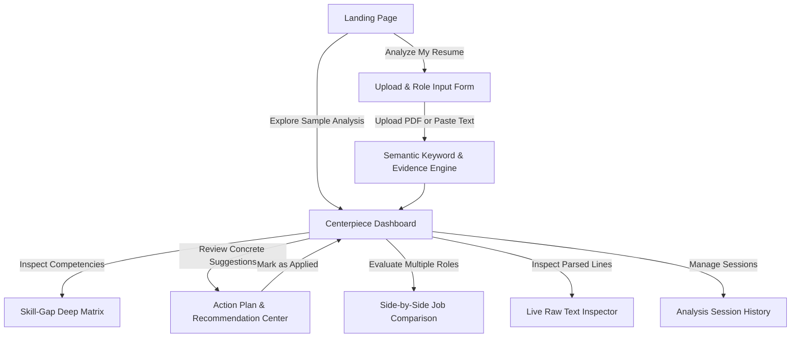

# Case Study: ResumeIQ — Career Intelligence Platform

**Role:** Product Designer, Design Systems Architect & Frontend Engineer  
**Platform:** Web Application (Responsive: Mobile, Tablet, Desktop)  
**Timeline:** Portfolio Production Build  
**Stack:** React 18, TypeScript, Tailwind CSS, Space Grotesk & Inter Typography, PDF.js, LocalStorage  

---

## 1. Product Overview & Executive Summary

**ResumeIQ** is an evidence-based career intelligence platform engineered for university students, recent graduates, and early-career job seekers. Rather than presenting an arbitrary, anxiety-inducing score, ResumeIQ demystifies the resume screening process by mapping exact bullet-point evidence against job description requirements.

### The Five Core Questions ResumeIQ Answers:
1. **Alignment:** How clearly does my resume communicate relevance to this specific role?
2. **Demonstrated Evidence:** Which required competencies are supported by quantifiable project accomplishments?
3. **Skill Gaps:** Which critical skills are missing or weakly substantiated?
4. **Actionable Relevance:** What concrete phrasing transformations will make my achievements clearer to recruiters?
5. **Next Decisions:** Which prioritized actions should I take to improve my interview conversion rate?

---

## 2. Problem Statement & User Research Framing

### The Problem
Early-career candidates face a frustrating "black box" when applying to modern tech roles. Traditional Applicant Tracking Systems (ATS) and algorithmic screeners filter out qualified applicants who fail to use exact terminology or structure their achievements with quantifiable impact. 

Existing commercial resume tools suffer from three fundamental design failures:
1. **Judgemental Scoring:** Presenting an opaque "62/100" score without explaining *why* or how to improve, inducing panic and imposter syndrome.
2. **Fabrication Incentives:** Prompting users to blindly stuff buzzwords into their resumes even if they have never touched the technology.
3. **Vague Recommendations:** Offering generic advice like *"Add more action verbs"* without providing contextual before/after examples tailored to the job description.

### Target Audience
* **University Students & Interns:** Preparing for campus placements, summer internships, and first-time technical screenings.
* **New Graduates:** Transitioning academic coursework and capstone projects into industry-standard resumes.
* **Early-Career Career Switchers:** Needing to identify transferable skills and bridge specific technical gaps.

---

## 3. Design Principles

| Principle | Design Execution in ResumeIQ |
| :--- | :--- |
| **Reassuring Over Judgmental** | Alignment is framed as *clarity of communication against a single posting*, explicitly disclaiming that scores predict hiring certainty. |
| **Evidence-Backed Citations** | Every identified skill cites the exact sentence from the job description and the exact bullet from the resume. |
| **Actionable Before/Afters** | Recommendations provide real before-and-after phrasing diffs following the formula: `[Action Verb] + [What Was Built] + [Quantified Outcome]`. |
| **Zero-Fabrication Guardrail** | Explicit warnings prevent candidates from claiming unearned skills, focusing instead on articulating genuine coursework and projects. |
| **Privacy by Architecture** | 100% in-browser processing via client-side PDF parsing and semantic evaluation. Zero personal telemetry or resume storage on remote servers. |

---

## 4. Information Architecture & End-to-End User Journey

### Detailed Journey Steps:
1. **Landing & Orientation:** The candidate understands the product promise, explores live interactive previews, and reads the privacy guarantee.
2. **Intelligent Upload & Ingestion:** The user uploads a PDF or pastes raw resume text. Real client-side parsing provides immediate progress feedback (with sample presets for one-click demonstration).
3. **Synthesis & Alignment Dashboard:** High-level gauge visualization accompanied by contextual meaning, core metric breakdown, detected strengths, and priority areas for improvement.
4. **Deep Competency Matrix:** Users inspect which skills were categorized as *Demonstrated* (with project proof), *Weak Evidence* (keyword in list only), or *Missing Gap* (not found).
5. **Action Plan Execution:** Candidates review concrete suggestions with before/after phrasing and check off completed edits.
6. **Strategic Role Comparison:** Evaluates trade-offs between two job postings (e.g. Frontend vs Fullstack) to choose optimal preparation strategies.

---

## 5. Visual Design System

ResumeIQ uses a modern editorial SaaS aesthetic that avoids neon glow gimmicks and generic dashboard templates.

* **Primary Background:** Deep Navy (`#0A0F1E`) — Calming, focused, low eye-strain.
* **Elevated Surfaces:** Muted Slate (`#151D33`) and Card Base (`#0F172A`).
* **Brand Primary:** Electric Indigo (`#6366F1`) & Soft Lavender (`#E0E7FF`).
* **Status Colors (Accessible, Multi-Signal):**
  * *Demonstrated:* Emerald (`#10B981`) with checkmark icons.
  * *Weak Evidence:* Amber (`#F59E0B`) with questioning help icons.
  * *Missing Gap:* Rose (`#F43F5E`) with cross icons.
* **Typography:**
  * **Headings:** *Space Grotesk* — Geometric, technical, modern editorial feel.
  * **Body & UI:** *Inter* — Industry standard for legibility at small sizes.
  * **Code & Citations:** *JetBrains Mono* / System Mono — For extracted resume quotes.

---

## 6. Accessibility & Technical Details

1. **Non-Color Reliance:** All statuses combine high-contrast colors, explicit text badges, and distinct SVG icons to ensure WCAG 2.1 AA compliance for colorblind users.
2. **Keyboard Navigation:** Full focus rings (`outline: 2px solid #6366F1`) across all interactive cards, filters, checkboxes, and buttons.
3. **Reduced Motion:** CSS `@media (prefers-reduced-motion: reduce)` rules disable all transitions and spin animations for sensitive users.
4. **Client-Side PDF Parsing:** Uses `pdfjs-dist` to parse documents in the browser worker thread, keeping candidate PII on their local machine.
5. **Session Persistence:** Analysis sessions and recommendation checklist states are persisted in `localStorage`.

---

## 7. Genuine Research & Testing Placeholders

*(Note for Portfolio Reviewers: The placeholders below are designated for live usability testing sessions, recorded interview transcripts, and Figma iteration snapshots.)*

### A. Candidate Interview Insights (Placeholder)
> *[Add notes here from your 3-5 user interviews with university students or recent grads]*
> - **Participant 1 (Junior CS Major):** Observed initial hesitation around score interpretation; reacted positively when scores were explained as "communication clarity" rather than a hiring verdict.
> - **Participant 2 (Product Design Grad):** Highlighted the need for before-and-after phrasing diffs to understand how to rewrite bullets without inflating achievements.

### B. Usability Testing & Iteration Log (Placeholder)
> *[Add usability test findings, task completion rates, and prototype iteration changes]*
> - **Task 1 (Upload & Parse):** 100% completion rate with PDF upload and one-click sample switcher.
> - **Task 2 (Inspecting Why a Skill Was Partial):** Users clicked the inspection card and immediately understood the distinction between a keyword tag and project proof.

### C. Figma & Wireframe References (Placeholder)
> *[Embed Figma Links, wireframe snapshots, and component library variants here]*
> - Figma Project File: `[Add your public Figma link here]`
> - Component Architecture: Design tokens for color, typography, spacing, and elevation.

---

## 8. Future Roadmap

1. **ATS Formatting Simulation:** Visualizing resume text flow in standard ATS plain-text parsing pipelines.
2. **Cover Letter Alignment:** Generating contextual cover letter outlines matching the candidate's verified project evidence.
3. **Role Track Benchmarking:** Comparing candidate evidence against hundreds of aggregated placement listings in software engineering, product management, and UX design.
